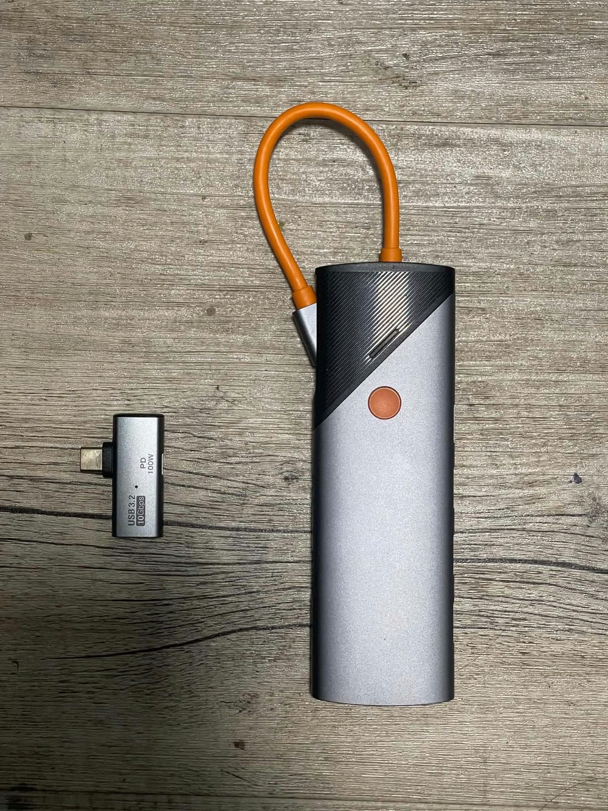
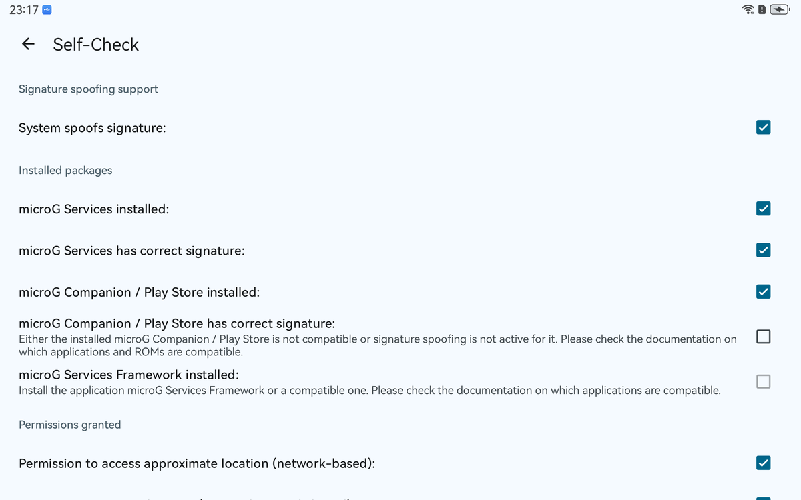
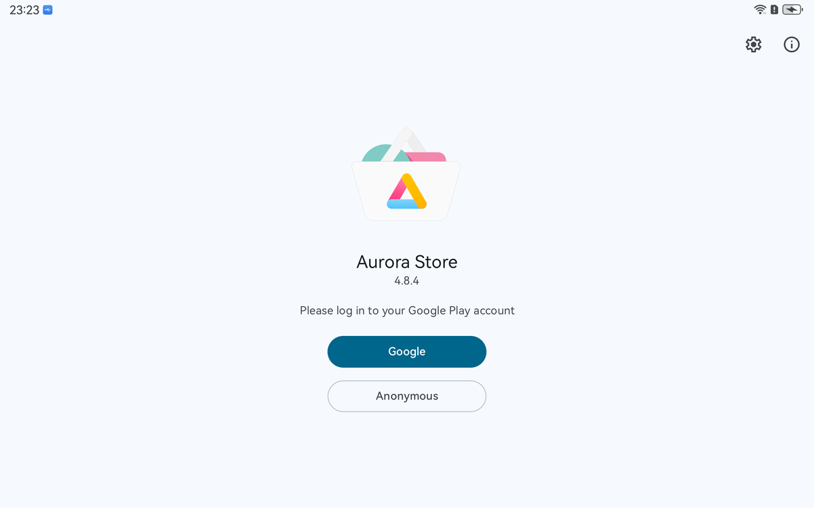

# MatePad 11 (DBY-W09) → HarmonyOS 4.2 C00 + microG — English guide

> Field-tested on a **Huawei MatePad 11 (2021) DBY-W09S**, 6/NN GB, Snapdragon 865/870 (`kona`).
> Start state: `2.0.0.278 (C432E2R2P1)`, Android 10, bootloader locked.
> End state: `4.2.0.208 (C00E100)`, Android 12, bootloader **unlocked**, microG signature spoofing **ON**.

Legend: 🖥 = on the PC, 📱 = on the tablet.

---

## 0. What the procedure actually does

| Stage | Goal | Tool |
|---|---|---|
| A | Full EDL backup (emergency kit) | `edl.py` |
| B | Erase the global region identity (`oeminfo`) | `edl.py` |
| C | Install **Chinese HarmonyOS 2** (rebrand → C00) | Recovery + USB stick |
| D | Restore the **unlocked ABL** | `edl.py` |
| E | Flash **HarmonyOS 4.2 C00** | `fastboot` |
| F | Install **microG `-hw`** + Aurora Store | `adb` |

Stage C is mandatory: a C432 device refuses to boot a CN system, and the 4.2 partition layout
differs from the HOS 2 one. The stock updater does the repartitioning for you — that is the whole
point of using `dload` instead of hand-flashing.

---

## 1. Prerequisites

🖥 Windows 10/11, Python 3.10+, [platform-tools](https://developer.android.com/tools/releases/platform-tools),
[bkerler/edl](https://github.com/bkerler/edl), `pip install -r requirements.txt`.

🖥 A **USB flash drive ≥ 8 GB** formatted **NTFS**, labelled anything, with a folder `dload\` at the root.
Plus a **USB-C OTG adapter or hub** — this is how the tablet reads the stick:



📦 Download and verify (see the hash table in the README):

```
update_full_base.zip                     CN HOS 4.2 base
update_full_cust_DBY-W09_all_cn.zip      CN HOS 4.2 cust
update_full_preload_DBY-W09_all_cn_R1.zip CN HOS 4.2 preload
update_sd_base.zip                       CN HOS 2 dload (rebrand)
update_sd_cust_DBY-W09_all_cn.zip
update_sd_preload_DBY-W09_all_cn_R5.zip
blank_oeminfo.img                        region identity eraser
abl_hw865870unlock.elf                   unlocked ABL
dbyprog_emmc_firehose                    EDL loader
```

Put the three `update_sd_*.zip` **as files** (not extracted) inside `dload\` on the stick.

📱 Developer options → **USB debugging** ON. Accept the RSA prompt on the PC.

---

## 2. Stage A — EDL backup

🖥 Boot the tablet into EDL and bind the WinUSB driver **once per PC**:

```powershell
adb reboot edl
# screen goes black; in Device Manager a "QUSB_BULK_CID:…" device appears
# Zadig → Options → List All Devices → select QUSB_BULK_CID… → target WinUSB → Replace Driver
```

🖥 Then run:

```powershell
.\scripts\edl-env.ps1
python $Edl edl.py printgpt --memory=ufs --lun=0 --loader=$Loader   # sanity: 40 partitions
.\scripts\backup.ps1                                                # ~12.9 GB, skips userdata
```

**Verify before continuing:** the backup folder holds ~90 files, `lun4\abl.bin` is exactly
4 194 304 bytes and starts with `7F 45 4C 46` (ELF), `lun4\boot.bin` starts with `ANDROID!`,
`lun0\oeminfo.bin` is 100 663 296 bytes. Copy `oeminfo.bin` and `abl.bin` to a second disk.

> ⚠️ If `edl.py` dies mid-session the tablet lands in **Sahara error state**
> (`Mode detected: error`). The only fix is a forced power cycle: hold **Power 20–30 s**.
> Always set `PYTHONIOENCODING=utf-8` (the scripts do) — edl's progress bar crashes on cp1252.

---

## 3. Stage B — blank `oeminfo`

Still in EDL:

```powershell
.\scripts\blank-oeminfo.ps1     # writes blank_oeminfo.img to LUN 0, verifies by read-back
```

At the end the tablet powers off. This is expected.

---

## 4. Stage C — install Chinese HarmonyOS 2 (`dload`)

1. Safely eject the USB stick from the PC, plug it into the **OTG hub**, plug the hub into the tablet.
   (Plugging USB can wake the tablet — that is fine.)
2. 📱 Hold **Power 15 s** → tablet off. Then **hold Vol+ and press Power**, release Power when the
   Huawei logo appears, keep holding Vol+ ~5 s → **Recovery**.
3. In Recovery (may be in Chinese):
   * `升级模式` / **Update mode**
   * `存储卡/OTG升级` / **Memory card/OTG update**
4. It verifies the package, repartitions and writes. 10–20 minutes. **Do not unplug anything.**
5. When it reports success: **factory reset**, then reboot.

Verify on the tablet: **Settings → About tablet → Build number** must read
`DBY-W09 2.0.0.273 (C00E210)` (or another `C00…`). If it still says `C432`, the update did not run.

```powershell
adb shell getprop ro.build.display.id     # DBY-W09 2.0.0.273(C00E210)
```

---

## 5. Stage D — restore the unlocked ABL

The `dload` reflashed a stock ABL, so the bootloader is locked again
(`verifiedbootstate=green`, `flash.locked=1`).

```powershell
adb reboot edl
.\scripts\unlock-abl.ps1        # writes abl_hw865870unlock.elf to LUN 4 + verifies by read-back
adb reboot bootloader
fastboot getvar unlocked        # must print: unlocked: yes
fastboot getvar is-userspace    # must print: is-userspace: no
```

---

## 6. Stage E — flash HarmonyOS 4.2

The CN 4.2 package is distributed as three HOTA zips, each containing `UPDATE.APP` + `PTABLE.APP`.
Extract the images and let the staging script validate every file against the **live** partition table:

```powershell
python .\scripts\extract_updateapp.py  update_full_base.zip      -o work\base
python .\scripts\extract_updateapp.py  update_full_cust_*.zip    -o work\cust
python .\scripts\extract_updateapp.py  update_full_preload_*.zip -o work\preload
python .\scripts\sparse.py             work\base\super_part0.img work\base\super_part1.img -o work\super.img
python .\scripts\stage-flash.py        -i work -o stage           # prints a fit table, must end "ALL GOOD"
```

`stage-flash.py` refuses to continue if any image is larger than its partition, and it never stages
`abl` (keeps the unlock) or `gpt` files.

Then:

```powershell
adb reboot bootloader
fastboot getvar is-userspace     # "no" — abort if "yes"
.\scripts\flash-hos42.ps1        # 41 partitions, ~9 GB, ~5 min over USB 3
```

The script stops at the first failure, and it does **not** reboot the tablet.

```powershell
fastboot reboot
adb wait-for-device
adb shell getprop ro.build.display.id     # DBY-W09 4.2.0.208(C00E100)
adb shell getprop ro.build.version.release # 12
adb shell getprop ro.boot.flash.locked     # 0  → still unlocked
```

> ⚠️ If the build does not boot, **do not panic-reboot**. Hold Power 20 s, go back to fastboot
> (`Vol-` while plugging the cable) and re-run `flash-hos42.ps1`, or restore the backup
> (`scripts/` has the reverse path documented in §9).

---

## 7. Stage F — Google services (microG)

microG is a re-implementation of Play Services. The **`-hw`** builds are the ones Huawei devices
need: on HarmonyOS 4.2 the system reports `System spoofs signature: ✓`, which is impossible on HOS 2.

```powershell
# microG GmsCore (Huawei build)
curl.exe -L -o gms-hw.apk     https://github.com/microG/GmsCore/releases/download/v0.3.17.252432/com.google.android.gms-252432034-hw.apk
curl.exe -L -o vending-hw.apk https://github.com/microG/GmsCore/releases/download/v0.3.17.252432/com.android.vending-84022634-hw.apk
adb install -r -g gms-hw.apk
adb install -r -g vending-hw.apk

# permissions microG needs
adb shell pm grant com.google.android.gms android.permission.ACCESS_FINE_LOCATION
adb shell pm grant com.google.android.gms android.permission.ACCESS_COARSE_LOCATION
adb shell pm grant com.google.android.gms android.permission.ACCESS_BACKGROUND_LOCATION

# Aurora Store (F-Droid build)
curl.exe -L -o aurora.apk https://f-droid.org/repo/com.aurora.store_76.apk
adb install -r -g aurora.apk

# OTA off (4.2 re-enables it)
adb shell settings put global ota_disable_automatic_update 1
adb shell settings put global auto_update_apps 0
```

📱 Open **microG Settings → Self-Check**. Expected:



* `System spoofs signature` ✓
* `microG Services installed` ✓ / `has correct signature` ✓
* `microG Companion / Play Store installed` ✓ — *its signature check stays red*; that only affects
  the real Play Store, not Aurora.
* `microG Services Framework` ✗ — expected, microG does not ship GSF.

Then **Google Accounts → Add account** and sign in. Google may warn
*"This browser or app may not be secure"* — retry, or use an app password.

Finally open **Aurora Store** and pick *Google* (uses your microG account) or *Anonymous*:



---

## 8. Optional: root (APatch)

Only needed for system-level tweaks (hosts/AdAway, debloating, build.prop).
The `boot` partition of HOS 4.2 **does** contain a ramdisk, so APatch works here
(it does **not** work on HOS 2, where Huawei splits kernel and ramdisk into two partitions).

1. Install `APatch_*.apk`, push a stock `boot.img` (or `bootHMOS4.2.img` from the community pack).
2. APatch → *Patch image* → pull the patched file.
3. `adb reboot bootloader` → `fastboot flash boot patched_boot.img` → `fastboot reboot`.
4. Open APatch, set the superkey.

---

## 9. Troubleshooting

| Symptom | Cause | Fix |
|---|---|---|
| `Mode detected: error` in `edl.py` | previous session died mid-transfer (Sahara error state) | hold **Power 20–30 s**, re-enter EDL |
| Tablet stuck on the Huawei logo, no USB at all | kernel panic after a half-flash | hold Power 20 s → `Vol-` + cable → fastboot → re-flash |
| Boot loop **with** fastboot available | wrong/incomplete system images | check `fastboot getvar is-userspace` = no, re-run `flash-hos42.ps1` |
| `dload` says *version check failed* | `oeminfo` still carries C432 | repeat stage B, then stage C |
| Recovery will not open | `Vol+` released too early | hold Vol+ first, then Power, release Power at the logo |
| `fastboot flash` hangs on `super` | USB 2 port / hub | plug straight into a USB 3 port, retry |
| microG self-check: spoofing red | installed on HOS 2, or non-`-hw` build | must be HOS 4.2 + `-hw` APK |

### Full rollback

The C432 backup restores the original system:

```powershell
adb reboot bootloader
# writes every partition from backups\...\lun{0,1,4}, keeps the unlocked ABL
.\scripts\restore-backup.ps1 -Backup "D:\edl-backup"
fastboot reboot
```

---

## 10. What you get (and what you lose)

**Works:** Play Store apps via Aurora, Google account, push notifications (microG Cloud Messaging),
location, most Google-dependent apps, pen and camera (vendor stack untouched), OTA permanently disabled.

**Does not work:** Play Integrity / SafetyNet (banking apps, Netflix HD), the real Play Store,
Google Cast targets that require GMS, Huawei's global services (you are on a Chinese ROM).

**Security note:** the bootloader stays unlocked (`verifiedbootstate=orange`), so anyone with
physical access can flash the tablet. Keep the EDL backup offline.
